# CarbonTracker: GSoC 2026 Final Report

**AOSSIE** · Contributor: Aneesa Fatima [GitHub](https://github.com/aneesafatima) · Mentors:
Bhavik, Madhav, Bruno · Project size: Large (360 Hours) · Project: CarbonTracker

**Repo:**  https://github.com/AOSSIE-Org/CarbonTracker (mobile app)

https://github.com/AOSSIE-Org/CarbonTracker-WatchCompanionApp (watch app)

**Final GSoC state:** [v1.0.3 (mobile)](https://github.com/AOSSIE-Org/CarbonTracker/releases/tag/v1.0.3) · [v1.0.1 (watch)](https://github.com/AOSSIE-Org/CarbonTracker-WatchCompanionApp/releases/tag/v1.0.1)

<table align="center">
  <tr>
    <td align="center">
       
      <b>AOSSIE</b>
    </td>
    <td align="center">
       
      <b>CarbonTracker</b>
    </td>
  </tr>
</table>

  <b>38 PRs merged</b> across CarbonTracker (mobile) and CarbonTracker-WatchCompanionApp (Wear OS)

## Summary

CarbonTracker is an open-source, privacy-first fitness and carbon-tracking app developed under
AOSSIE, combining health metrics, route tracking, and estimated carbon savings from sustainable
travel choices.

Shipped a Flutter mobile app with health data integration, map-based activity recording, carbon
emission comparisons, and a Wear OS companion app for activity tracking and synchronization. It is
designed for fitness enthusiasts and environmentally conscious individuals who want to track their
activities and understand their environmental impact while keeping their data private.

## App Screenshots (taken Android)

### Mobile app

<table align="center">
  <tr>
    <td align="center">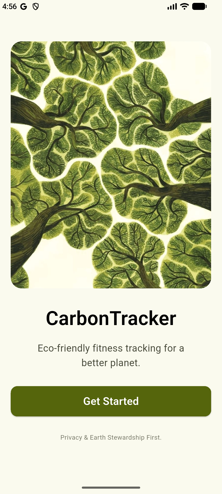 Onboarding</td>
    <td align="center">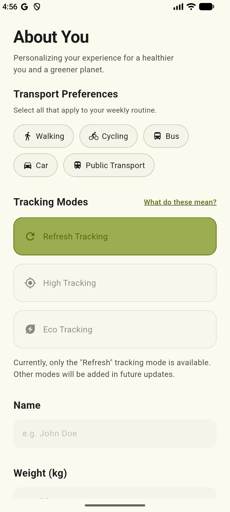 User info</td>
    <td align="center">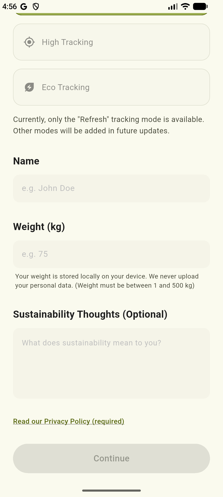 User info</td>
  </tr>
  <tr>
    <td align="center">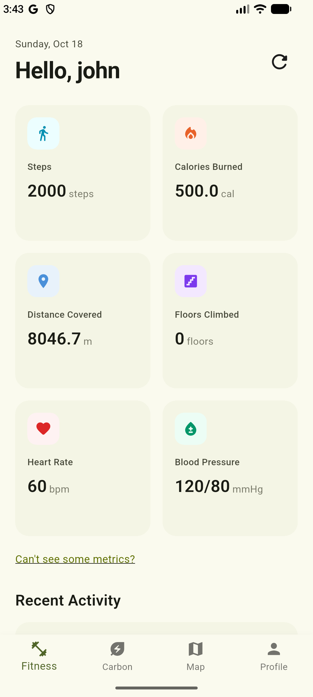 Fitness metrics</td>
    <td align="center">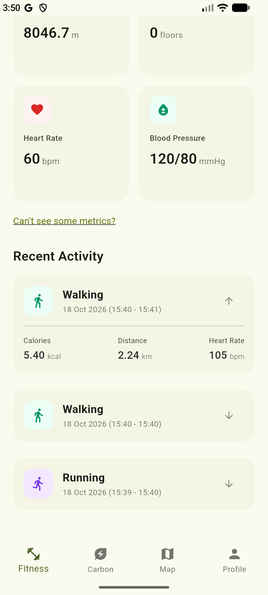 Fitness metrics</td>
    <td align="center">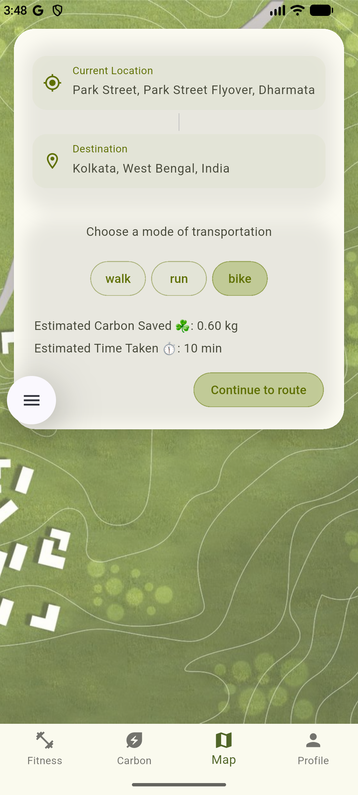 Map screen</td>
  </tr>
  <tr>
    <td align="center">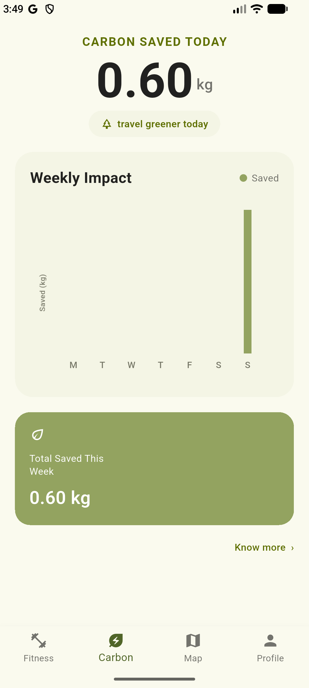 Carbon Screen</td>
    <td align="center">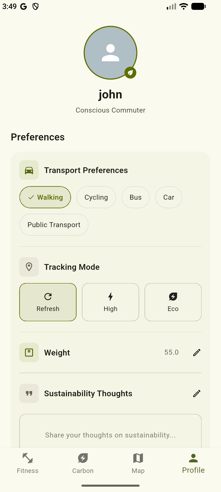 Profile Screen</td>
    <td align="center">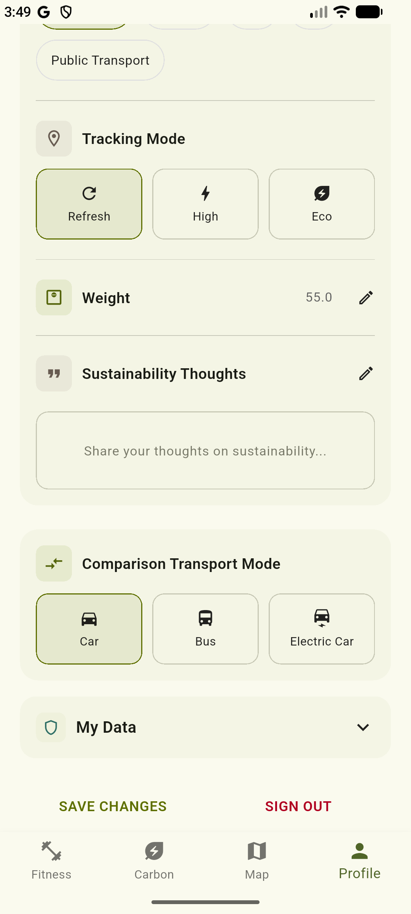 Profile Screen</td>
  </tr>
</table>

### Wear OS companion app

<table align="center">
  <tr>
    <td align="center">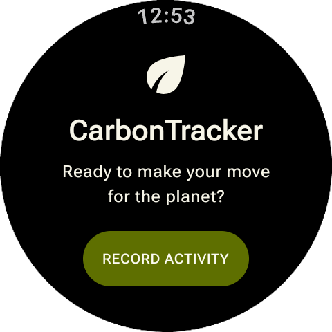 Onboarding</td>
    <td align="center">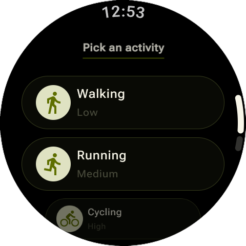 Activity selection</td>
    <td align="center">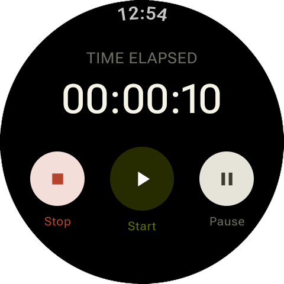 Stopwatch and tracking</td>
  </tr>
</table>

## Status at a Glance

### Mobile app ([CarbonTracker](https://github.com/AOSSIE-Org/CarbonTracker))

| Deliverable                                                                 | Status                   | Evidence                                                                                                                                                                                                                                                                                                                  |
|-----------------------------------------------------------------------------|--------------------------|---------------------------------------------------------------------------------------------------------------------------------------------------------------------------------------------------------------------------------------------------------------------------------------------------------------------------|
| App foundation (architecture, SQLite, onboarding, Riverpod)                 | ✅ Merged                 | [#1](https://github.com/AOSSIE-Org/CarbonTracker/pull/1), [#2](https://github.com/AOSSIE-Org/CarbonTracker/pull/2), [#5](https://github.com/AOSSIE-Org/CarbonTracker/pull/5)                                                                                                                                              |
| Fitness metrics via Health Connect / HealthKit                              | ✅ Merged                 | [#6](https://github.com/AOSSIE-Org/CarbonTracker/pull/6), [#7](https://github.com/AOSSIE-Org/CarbonTracker/pull/7), [#8](https://github.com/AOSSIE-Org/CarbonTracker/pull/8), [#29](https://github.com/AOSSIE-Org/CarbonTracker/pull/29)                                                                                  |
| Carbon dashboard and comparison modes                                       | ✅ Merged                 | [#9](https://github.com/AOSSIE-Org/CarbonTracker/pull/9), [#23](https://github.com/AOSSIE-Org/CarbonTracker/pull/23)                                                                                                                                                                                                      |
| Map and location-based trip tracking                                        | ✅ Merged                 | [#10](https://github.com/AOSSIE-Org/CarbonTracker/pull/10), [#11](https://github.com/AOSSIE-Org/CarbonTracker/pull/11), [#23](https://github.com/AOSSIE-Org/CarbonTracker/pull/23)                                                                                                                                        |
| Profile, data export, monthly reset                                         | ✅ Merged                 | [#12](https://github.com/AOSSIE-Org/CarbonTracker/pull/12), [#13](https://github.com/AOSSIE-Org/CarbonTracker/pull/13)                                                                                                                                                                                                    |
| Wear OS integration (phone side)                                            | ✅ Merged                 | [#20](https://github.com/AOSSIE-Org/CarbonTracker/pull/20), [#21](https://github.com/AOSSIE-Org/CarbonTracker/pull/21), [#22](https://github.com/AOSSIE-Org/CarbonTracker/pull/22), [#26](https://github.com/AOSSIE-Org/CarbonTracker/pull/26)                                                                            |
| Automated tests (unit, widget, integration)                                 | ✅ Merged                 | [#13](https://github.com/AOSSIE-Org/CarbonTracker/pull/13), [#24](https://github.com/AOSSIE-Org/CarbonTracker/pull/24), [#25](https://github.com/AOSSIE-Org/CarbonTracker/pull/25), [#34](https://github.com/AOSSIE-Org/CarbonTracker/pull/34) (CI workflow)                                                              |
| CI/CD and release automation                                                | ✅ Merged · 🔄 1 fix open | [#28](https://github.com/AOSSIE-Org/CarbonTracker/pull/28), [#34](https://github.com/AOSSIE-Org/CarbonTracker/pull/34), [#36](https://github.com/AOSSIE-Org/CarbonTracker/pull/36) · [#42](https://github.com/AOSSIE-Org/CarbonTracker/pull/42) (open) · [releases](https://github.com/AOSSIE-Org/CarbonTracker/releases) |
| Security and project health (CodeRabbit, Scorecard, checklist, SECURITY.md) | ✅ Merged                 | [#15](https://github.com/AOSSIE-Org/CarbonTracker/pull/15), [#16](https://github.com/AOSSIE-Org/CarbonTracker/pull/16), [#33](https://github.com/AOSSIE-Org/CarbonTracker/pull/33), [#35](https://github.com/AOSSIE-Org/CarbonTracker/pull/35), [#39](https://github.com/AOSSIE-Org/CarbonTracker/pull/39)                |
| Documentation and privacy policy                                            | ✅ Merged                 | [#14](https://github.com/AOSSIE-Org/CarbonTracker/pull/14), [#26](https://github.com/AOSSIE-Org/CarbonTracker/pull/26), [#32](https://github.com/AOSSIE-Org/CarbonTracker/pull/32), [#39](https://github.com/AOSSIE-Org/CarbonTracker/pull/39)                                                                            |
| F-Droid release                                                             | 🔄 MR open               | [#38](https://github.com/AOSSIE-Org/CarbonTracker/pull/38) (metadata) · **https://gitlab.com/fdroid/fdroiddata/-/merge_requests/54194**                                                                                                                                                                                   |
| iOS App Store                                                               | 🔄 In review             | Submitted 29 Oct 2026, addressing issues raised by Apple                                                                                                                                                                                                                                                                  |
| Not done / limitations                                                      | ❌                        | Only the "Refresh" tracking mode is supported ([#29](https://github.com/AOSSIE-Org/CarbonTracker/pull/29)); watch activity sync is Android-only ([#22](https://github.com/AOSSIE-Org/CarbonTracker/pull/22)) · see Future Work                                                                                            |

### Wear OS companion app ([CarbonTracker-WatchCompanionApp](https://github.com/AOSSIE-Org/CarbonTracker-WatchCompanionApp))

| Deliverable                                                                                         | Status       | Evidence                                                                                                                                                                                                                                                                                                                                                    |
|-----------------------------------------------------------------------------------------------------|--------------|-------------------------------------------------------------------------------------------------------------------------------------------------------------------------------------------------------------------------------------------------------------------------------------------------------------------------------------------------------------|
| Watch UI (onboarding, activity selection, stopwatch)                                                | ✅ Merged     | [#19](https://github.com/AOSSIE-Org/CarbonTracker-WatchCompanionApp/pull/19)                                                                                                                                                                                                                                                                                |
| Local storage (Room database)                                                                       | ✅ Merged     | [#22](https://github.com/AOSSIE-Org/CarbonTracker-WatchCompanionApp/pull/22), [#24](https://github.com/AOSSIE-Org/CarbonTracker-WatchCompanionApp/pull/24)                                                                                                                                                                                                  |
| Exercise tracking via Health Services (distance, calories, heart rate)                              | ✅ Merged     | [#23](https://github.com/AOSSIE-Org/CarbonTracker-WatchCompanionApp/pull/23), [#24](https://github.com/AOSSIE-Org/CarbonTracker-WatchCompanionApp/pull/24)                                                                                                                                                                                                  |
| Phone ↔ watch sync (listener service, unsynced records sent as JSON, marked synced only on success) | ✅ Merged     | [#22](https://github.com/AOSSIE-Org/CarbonTracker-WatchCompanionApp/pull/22), [#24](https://github.com/AOSSIE-Org/CarbonTracker-WatchCompanionApp/pull/24) · phone side: [#20](https://github.com/AOSSIE-Org/CarbonTracker/pull/20), [#22](https://github.com/AOSSIE-Org/CarbonTracker/pull/22), [#26](https://github.com/AOSSIE-Org/CarbonTracker/pull/26) |
| Production config and release workflow                                                              | ✅ Merged     | [#25](https://github.com/AOSSIE-Org/CarbonTracker-WatchCompanionApp/pull/25)                                                                                                                                                                                                                                                                                |
| Documentation (config markdown files)                                                               | ✅ Merged     | [#28](https://github.com/AOSSIE-Org/CarbonTracker-WatchCompanionApp/pull/28)                                                                                                                                                                                                                                                                                |
| Security review and remediation report                                                              | 🔄 In review | [#39](https://github.com/AOSSIE-Org/CarbonTracker-WatchCompanionApp/pull/39) (consolidated PR; replaces closed #33, #37, #38)                                                                                                                                                                                                                               |
| Repo workflows (issue moderator, anti-slop PR)                                                      | 🔄 In review | [#39](https://github.com/AOSSIE-Org/CarbonTracker-WatchCompanionApp/pull/39) (replaces closed #34)                                                                                                                                                                                                                                                          |
| Release fixes and SECURITY.md                                                                       | 🔄 In review | [#39](https://github.com/AOSSIE-Org/CarbonTracker-WatchCompanionApp/pull/39) (replaces closed #35)                                                                                                                                                                                                                                                          |

## Goals

- Combine fitness tracking with carbon savings estimation.
- Enable map-based tracking for walking, running, and cycling.
- Integrate health metrics from supported health platforms.
- Compare carbon savings against alternative transport modes.
- Develop a Wear OS companion app for activity tracking and synchronization.
- Prioritize user privacy through local data storage and account-free access.
- Build an open-source, cross-platform application under AOSSIE.

## What I Built

### Mobile app

#### 1. Local-first data and user control

**Why:** Track fitness and carbon impact without an account or a CarbonTracker server.

- SQLite storage for the profile, trips and watch activity (schema v2 with a migration for existing
  installs)
- Profile edit/delete, trip deletion, automatic monthly trip reset
- JSON export of trip history via the system share sheet

**Key decision:** No backend or account. The one external service is Nominatim for place search
and reverse geocoding; this is disclosed in the privacy policy.

**PRs:** [#1](https://github.com/AOSSIE-Org/CarbonTracker/pull/1), [#12](https://github.com/AOSSIE-Org/CarbonTracker/pull/12), [#13](https://github.com/AOSSIE-Org/CarbonTracker/pull/13), [#22](https://github.com/AOSSIE-Org/CarbonTracker/pull/22)

#### 2. Health data (Health Connect / HealthKit)

**Why:** Show fitness metrics next to environmental impact.

- Steps, distance, calories, floors climbed, heart rate and blood pressure from the platform health
  APIs
- Permission flow, a Health Connect rationale screen, and a "can't see some metrics?" explainer
- Loading, refresh and empty states

**Key decision:** Show "N/A" when a metric needs a wearable and none is connected, instead of
placeholder numbers.

**PRs:** [#6](https://github.com/AOSSIE-Org/CarbonTracker/pull/6), [#7](https://github.com/AOSSIE-Org/CarbonTracker/pull/7), [#8](https://github.com/AOSSIE-Org/CarbonTracker/pull/8), [#29](https://github.com/AOSSIE-Org/CarbonTracker/pull/29)

#### 3. Map and trip logging

**Why:** Let users record everyday journeys and see their impact.

- Device location (geolocator) and place search (Nominatim) for current and destination points
- Map screen with trips for walk, run and bike saved locally
- Location permissions and clear error messages on both platforms

**PRs:** [#10](https://github.com/AOSSIE-Org/CarbonTracker/pull/10), [#11](https://github.com/AOSSIE-Org/CarbonTracker/pull/11), [#23](https://github.com/AOSSIE-Org/CarbonTracker/pull/23)

#### 4. Carbon savings and comparisons

**Why:** Show what choosing an active mode saves.

- Per-km carbon savings as compared to a vehicle, weekly summaries, and a carbon saved bar chart (fl_chart)
- User-selectable comparison baseline (default: car)

**Key decision:** Results are presented as estimates against a baseline you choose, not exact avoided emissions.

**PRs:** [#11](https://github.com/AOSSIE-Org/CarbonTracker/pull/11), [#23](https://github.com/AOSSIE-Org/CarbonTracker/pull/23)

### Wear OS companion app

#### 5. On-watch tracking and storage

**Why:** Record workouts from the wrist without carrying the phone.

- Kotlin and Compose for Wear OS: onboarding, activity selection (walking, running, cycling),
  stopwatch with start/pause/stop
- Health Services via `ExerciseService` for distance, calories and heart rate
- Room database for sessions; sessions left unfinished by a crash are closed on startup

**PRs (watch repo):** [#19](https://github.com/AOSSIE-Org/CarbonTracker-WatchCompanionApp/pull/19), [#22](https://github.com/AOSSIE-Org/CarbonTracker-WatchCompanionApp/pull/22), [#23](https://github.com/AOSSIE-Org/CarbonTracker-WatchCompanionApp/pull/23), [#24](https://github.com/AOSSIE-Org/CarbonTracker-WatchCompanionApp/pull/24)

#### 6. Watch ↔ phone sync

**Why:** Get watch workouts into the phone app without a server.

- Wearable Data Layer messages: the phone requests data, the watch replies with unsynced exercises
  as JSON
- The phone saves them and sends back an acknowledgment; the watch marks records as synced
- 5-second timeout on the phone, plus watch heart rate as a fallback when the phone has no such data
  available

**Key decision:** Records are marked synced **only after a successful send and acknowledgment**,
so failures are retried instead of lost.

**PRs:**
watch [#22](https://github.com/AOSSIE-Org/CarbonTracker-WatchCompanionApp/pull/22), [#24](https://github.com/AOSSIE-Org/CarbonTracker-WatchCompanionApp/pull/24) ·
phone [#20](https://github.com/AOSSIE-Org/CarbonTracker/pull/20), [#21](https://github.com/AOSSIE-Org/CarbonTracker/pull/21), [#22](https://github.com/AOSSIE-Org/CarbonTracker/pull/22), [#26](https://github.com/AOSSIE-Org/CarbonTracker/pull/26)

#### 7. Phone-side watch integration

- Watch connection check, a "Recent Activity" section for synced workouts (Android only), and an
  Android prompt which helps the mobile app to connect with existing fitness apps on the said
  device, which I made non-blocking so onboarding can't get stuck

**PRs:** [#7](https://github.com/AOSSIE-Org/CarbonTracker/pull/7), [#41](https://github.com/AOSSIE-Org/CarbonTracker/pull/41)

### Quality, security and releases

#### 8. Testing

- Unit tests (carbon calculator), widget tests, and an onboarding integration test; `HealthService`
  refactored behind an interface and Riverpod provider so it can be faked in tests; Flutter tests
  run in CI

**Gap:** integration coverage is currently the onboarding flow only

**PRs:** [#13](https://github.com/AOSSIE-Org/CarbonTracker/pull/13), [#24](https://github.com/AOSSIE-Org/CarbonTracker/pull/24), [#25](https://github.com/AOSSIE-Org/CarbonTracker/pull/25), [#34](https://github.com/AOSSIE-Org/CarbonTracker/pull/34)

#### 9. Releases and distribution

- GitHub Actions release workflow triggered by a `VERSION` file change, with the APK attached to
  releases (v0.1.0 → v1.0.3)
- F-Droid metadata and merge request; iOS App Store submission (in review)

**PRs:** [#28](https://github.com/AOSSIE-Org/CarbonTracker/pull/28), [#36](https://github.com/AOSSIE-Org/CarbonTracker/pull/36), [#38](https://github.com/AOSSIE-Org/CarbonTracker/pull/38), [#41](https://github.com/AOSSIE-Org/CarbonTracker/pull/41), [#42](https://github.com/AOSSIE-Org/CarbonTracker/pull/42) (open) · watch [#25](https://github.com/AOSSIE-Org/CarbonTracker-WatchCompanionApp/pull/25)

#### 10. Security, documentation and project health

- CodeRabbit config, OpenSSF-style best practices checklist, Scorecard workflow, security review
  report, SECURITY.md, privacy policy, setup/contributing/architecture docs

**PRs:** [#14](https://github.com/AOSSIE-Org/CarbonTracker/pull/14), [#15](https://github.com/AOSSIE-Org/CarbonTracker/pull/15), [#16](https://github.com/AOSSIE-Org/CarbonTracker/pull/16), [#33](https://github.com/AOSSIE-Org/CarbonTracker/pull/33), [#39](https://github.com/AOSSIE-Org/CarbonTracker/pull/39)

## Architecture

### System overview

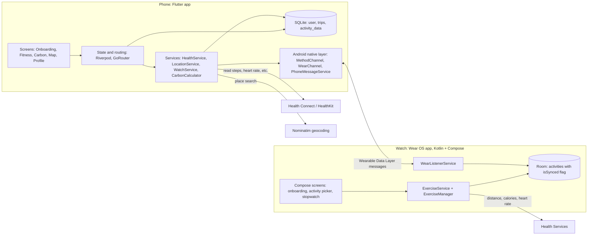

### Watch-to-phone sync

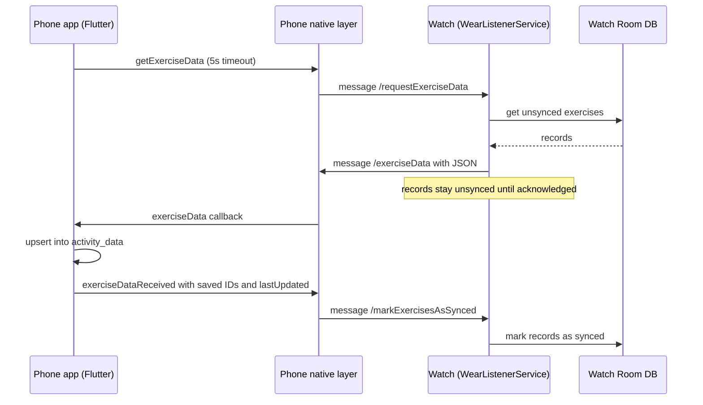

| Layer                 | Technology                                                   |
|-----------------------|--------------------------------------------------------------|
| Mobile UI and logic   | Flutter / Dart                                               |
| State and navigation  | Riverpod, GoRouter                                           |
| Local storage (phone) | SQLite via sqflite (schema v2 with migration)                |
| Health data           | `health` package: Health Connect (Android), HealthKit (iOS)  |
| Location and maps     | geolocator, Nominatim, flutter_osm_plugin, flutter_map       |
| Charts and sharing    | fl_chart, share_plus                                         |
| Watch app             | Kotlin, Jetpack Compose for Wear OS                          |
| Local storage (watch) | Room                                                         |
| Watch sensors         | Health Services (`ExerciseClient`)                           |
| Phone ↔ watch         | Wearable Data Layer messages, JSON via kotlinx.serialization |
| CI/CD and quality     | GitHub Actions, CodeRabbit, Scorecard                        |

## Releases & Distribution

*Status as of 30 Oct 2026. Store review is outside my control, so I'll update this table as
decisions come in.*

| Platform                        | Version                  | Status                                                | Link                                                                                 |
|---------------------------------|--------------------------|-------------------------------------------------------|--------------------------------------------------------------------------------------|
| **GitHub Releases** (phone app) | v0.1.0 → v1.0.3          | ✅ Published                                           | [Releases](https://github.com/AOSSIE-Org/CarbonTracker/releases)                     |
| **Google Play** (phone app)     | 1.0.0+1 live · 1.0.3+12  | ✅ Earlier version live · 🔄 New version in review     | [Play Store](https://play.google.com/store/apps/details?id=org.aossie.carbontracker) |
| **Google Play** (Wear OS app)   | 1.0.2+11 (first release) | 🔄 In review, addressing reviewer findings            | `N/A`                                                                                |
| **iOS App Store**               | 1.0.3                    | 🔄 In review, addressing issues raised by Apple       | `N/A`                                                                                |
| **F-Droid**                     | 1.0.3                    | 🔄 Merge request open, iterating on reviewer feedback | [Merge Request](https://gitlab.com/fdroid/fdroiddata/-/merge_requests/54194)         |
| **GitHub Releases** (watch app) | 1.0.1                    | ✅ signed-APK release workflow                         | [Releases](https://github.com/AOSSIE-Org/CarbonTracker-WatchCompanionApp/releases)   |

### What I did for releases

- **Pipeline:** a GitHub Actions workflow triggered by changing the `VERSION` file builds the app
  and creates the GitHub release. It was added
  in [#28](https://github.com/AOSSIE-Org/CarbonTracker/pull/28)
  and [#36](https://github.com/AOSSIE-Org/CarbonTracker/pull/36). A fix for how it handles draft vs.
  published releases is open in [#42](https://github.com/AOSSIE-Org/CarbonTracker/pull/42).
- **Android:** release signing, launcher icon and splash configuration, store graphics, and privacy
  policy.
- **F-Droid:** metadata files ([#38](https://github.com/AOSSIE-Org/CarbonTracker/pull/38)). I'm
  responding to reviewer comments on the MR, and addressed some of them
  in [#41](https://github.com/AOSSIE-Org/CarbonTracker/pull/41).
- **iOS:** App Store submission, including fixes for the issues raised during upload (app icon and
  Health permission descriptions) and a removal of iPad
  support ([#37](https://github.com/AOSSIE-Org/CarbonTracker/pull/37)).
- **Wear OS:** production configuration and a signed-APK release
  workflow ([#25](https://github.com/AOSSIE-Org/CarbonTracker-WatchCompanionApp/pull/25)), plus a
  first Play Store submission.

## Quality & Testing

**What's covered**

| Level       | What's tested                                                                                                             | PRs                                                                                                                    |
|-------------|---------------------------------------------------------------------------------------------------------------------------|------------------------------------------------------------------------------------------------------------------------|
| Unit        | Carbon savings calculation (`CarbonCalculator`), and fitness-metric aggregation (`HealthService.aggregateFitnessMetrics`) | [#13](https://github.com/AOSSIE-Org/CarbonTracker/pull/13), [#24](https://github.com/AOSSIE-Org/CarbonTracker/pull/24) |
| Widget      | Screen behaviour with the health service replaced by a fake                                                               | [#24](https://github.com/AOSSIE-Org/CarbonTracker/pull/24)                                                             |
| Integration | New-user onboarding flow: splash → onboarding → user info → main screen, with Continue disabled until the form is valid   | [#25](https://github.com/AOSSIE-Org/CarbonTracker/pull/25)                                                             |

**Automation and review tooling**

- A Flutter tests workflow runs in CI ([#34](https://github.com/AOSSIE-Org/CarbonTracker/pull/34)).
- CodeRabbit reviews every PR ([#15](https://github.com/AOSSIE-Org/CarbonTracker/pull/15)).
- OpenSSF Scorecard and best-practices checklist
  workflows ([#28](https://github.com/AOSSIE-Org/CarbonTracker/pull/28), [#16](https://github.com/AOSSIE-Org/CarbonTracker/pull/16), [#35](https://github.com/AOSSIE-Org/CarbonTracker/pull/35)).
- Issue-moderator and anti-slop-PR
  workflows ([#34](https://github.com/AOSSIE-Org/CarbonTracker/pull/34)).
- A security review report, plus a peer audit whose findings I
  fixed ([#33](https://github.com/AOSSIE-Org/CarbonTracker/pull/33), [#41](https://github.com/AOSSIE-Org/CarbonTracker/pull/41)),
  and a SECURITY.md ([#39](https://github.com/AOSSIE-Org/CarbonTracker/pull/39)).

**Honest gaps**

- Integration coverage is the onboarding flow only. Trip logging, the map, and the carbon dashboard
  end to end are not covered.
- The Wear OS app has no automated tests. Its sync logic was verified manually on device.
- No coverage percentage is tracked.
- Platform-specific behaviour (Health Connect, HealthKit, the watch Data Layer) is tested manually
  on devices and emulators.

## Challenges & Learnings

### 1. Writing my first tests in code that wasn't built for testing

**What broke:** I had never written a test before. My first attempt, a unit test for the carbon
calculator, was easy. But `HealthService` used static methods that called platform plugins directly,
so screens couldn't be tested without a real device.

**What I did:** Put the service behind an interface, injected the fetch functions, pulled the
aggregation logic into a pure function, and exposed the service through Riverpod so tests can
override it ([#24](https://github.com/AOSSIE-Org/CarbonTracker/pull/24)). I reused the same approach
for the integration test ([#25](https://github.com/AOSSIE-Org/CarbonTracker/pull/25)).

**Learned:** Testability is a design decision made early. Wrapping platform calls behind small
interfaces makes everything else easier to test.

### 2. Making watch-to-phone sync reliable

**What broke:** The first version sent data and moved on. If the watch didn't respond, the phone
call hung; if the watch died mid-workout, sessions were left without an end time; and records could
be lost if they were marked as sent too early.

**What I did, over several PRs:**

- Added timeouts and heart-rate
  fallback ([#21](https://github.com/AOSSIE-Org/CarbonTracker/pull/21)).
- Made the phone call return `success` or `error` instead of leaving it
  hanging ([#26](https://github.com/AOSSIE-Org/CarbonTracker/pull/26)).
- Added an acknowledgment step so the watch marks records synced only after the phone
  confirms ([#26](https://github.com/AOSSIE-Org/CarbonTracker/pull/26),
  watch [#24](https://github.com/AOSSIE-Org/CarbonTracker-WatchCompanionApp/pull/24)).
- Closed orphaned sessions on startup and saved final metrics when a workout
  ends ([watch #24](https://github.com/AOSSIE-Org/CarbonTracker-WatchCompanionApp/pull/24)).

**Learned:** Two devices over an unreliable link need an explicit "received" step, and "mark as
done" should only happen after the other side confirms.

### 3. Getting from "works on my machine" to store releases

**What broke:** Each distribution channel raised something different. The release workflow had to
handle draft vs. published releases ([#42](https://github.com/AOSSIE-Org/CarbonTracker/pull/42));
F-Droid reviewers asked for changes to the repo setup; Apple rejected the first iOS upload for icon
and health-permission description issues; and onboarding could get blocked when matchmaking
failed ([#41](https://github.com/AOSSIE-Org/CarbonTracker/pull/41)).

**What I did:** Worked through each round of review feedback, fixed the app and the workflow, and
kept version numbers and release metadata consistent across platforms.

**Learned:** Release engineering is its own skill. Each store has its own rules, and shipping is an
iterative conversation with reviewers, not a single push.

### How I worked

Several areas were new to me: native Android and Kotlin for the Wear OS app, writing tests, and
CI/release workflows. I used AI assistance to learn and implement them, then reviewed and iterated
on the results. I can explain the design of the tests and the watch sync in detail; I understand the
release workflows at an architectural level, and I'm still building fluency writing Kotlin from
scratch.

## Future Work

**Where the project stands:** CarbonTracker is a deliberately simple first version. It has what a v1
needs: local-first tracking, health metrics, trip logging with carbon estimates, a Wear OS
companion, tests, and releases. There is a lot of room to grow, and the roadmap below is the order
I'd approach it in.

| Area                     | Next steps                                                                                                                                                                                                                                                       |
|--------------------------|------------------------------------------------------------------------------------------------------------------------------------------------------------------------------------------------------------------------------------------------------------------|
| **Engagement**           | Gamification (streaks, badges, goals, weekly challenges), and real personalised recommendations to replace the placeholder recommendation card that I removed from the very basic version of the app([#26](https://github.com/AOSSIE-Org/CarbonTracker/pull/26)) |
| **Health integration**   | Use more of Health Connect and HealthKit (for example sleep, workouts, and write-back) while keeping the app simple and the permission set small                                                                                                                 |
| **Tracking modes**       | Only "Refresh" mode is supported today ([#29](https://github.com/AOSSIE-Org/CarbonTracker/pull/29)); add automatic background tracking                                                                                                                           |
| **Watch app**            | More features (for example in-workout metrics screens and more activity types), and watch sync on iOS, which is Android-only today ([#22](https://github.com/AOSSIE-Org/CarbonTracker/pull/22))                                                                  |
| **Wider device support** | Extend beyond Wear OS to other smartwatches, such as Apple Watch                                                                                                                                                                                                 |
| **Quality**              | Broader integration tests (trip logging, map, carbon dashboard), automated tests for the watch app, and coverage tracking                                                                                                                                        |
| **Releases**             | Complete store reviews (App Store, Play Store, F-Droid)                                                                                                                                                                                                          |

## Full PR List

<b>All mobile PRs (32 merged, 2 open)</b>

| PR                                                         | Title                                                 | Merged     | What it does                                                                                                                                       |
|------------------------------------------------------------|-------------------------------------------------------|------------|----------------------------------------------------------------------------------------------------------------------------------------------------|
| [#1](https://github.com/AOSSIE-Org/CarbonTracker/pull/1)   | Set up project architecture and SQLite database layer | 2026-06-02 | Feature-based structure and a singleton SQLite `DatabaseHelper` (user and trips tables) with custom exception handling.                            |
| [#2](https://github.com/AOSSIE-Org/CarbonTracker/pull/2)   | ui: onboarding screens                                | 2026-06-11 | Onboarding landing and user-info form (transport, tracking mode, weight), reusable info modal, GoRouter setup.                                     |
| [#5](https://github.com/AOSSIE-Org/CarbonTracker/pull/5)   | database: connect onboarding UI to SQLite             | 2026-06-16 | Splash screen that routes new vs returning users, Riverpod user provider and repository, form validation.                                          |
| [#6](https://github.com/AOSSIE-Org/CarbonTracker/pull/6)   | Feature/fitness metrics screen UI                     | 2026-06-16 | Fitness Metrics screen with a stats grid and expandable activity cards (sample data).                                                              |
| [#7](https://github.com/AOSSIE-Org/CarbonTracker/pull/7)   | Feature/implement matchmaking api                     | 2026-06-28 | Health Connect permissions and rationale screen, native Android matchmaking flow via MethodChannel, package migration, Gradle/AGP/Kotlin upgrades. |
| [#8](https://github.com/AOSSIE-Org/CarbonTracker/pull/8)   | feature:implemented health connect plugin             | 2026-07-02 | Live steps, distance, calories, heart rate and blood pressure from Health Connect/HealthKit, with loading, refresh and empty states.               |
| [#9](https://github.com/AOSSIE-Org/CarbonTracker/pull/9)   | feature:implemented carbon metrics screen             | 2026-07-08 | Carbon calculator, weekly summary providers and an fl_chart bar chart of emitted vs saved carbon.                                                  |
| [#10](https://github.com/AOSSIE-Org/CarbonTracker/pull/10) | feature:implemented map screen ui + location fetching | 2026-07-22 | Map screen with device location (geolocator), place search and reverse geocoding (Nominatim), location permissions on both platforms.              |
| [#11](https://github.com/AOSSIE-Org/CarbonTracker/pull/11) | Feature/map route tracking                            | 2026-07-22 | Current/destination search widgets, per-mode carbon calculation, trips read from the database instead of dummy data.                               |
| [#12](https://github.com/AOSSIE-Org/CarbonTracker/pull/12) | feature:implemented the profile screen                | 2026-08-12 | Profile screen (edit user, transport, tracking mode), monthly trip reset, map permission error handling.                                           |
| [#13](https://github.com/AOSSIE-Org/CarbonTracker/pull/13) | Feature/export user data                              | 2026-08-12 | JSON export of trip history via share_plus, first unit test (CarbonCalculator), CodeRabbit review fixes.                                           |
| [#14](https://github.com/AOSSIE-Org/CarbonTracker/pull/14) | Docs/add md files                                     | 2026-08-12 | Setup, contributing, privacy, architecture and branding documentation.                                                                             |
| [#15](https://github.com/AOSSIE-Org/CarbonTracker/pull/15) | chore:configured coderabbit.yaml                      | 2026-08-13 | CodeRabbit configuration, launcher icons and branding assets, privacy policy update.                                                               |
|                                                            | **Midterm evaluation**                                |            | *PRs above were completed before midterm; PRs below are from the second half.*                                                                     |
| [#16](https://github.com/AOSSIE-Org/CarbonTracker/pull/16) | docs: add best practices checklist                    | 2026-09-15 | OpenSSF-inspired best practices checklist.                                                                                                         |
| [#20](https://github.com/AOSSIE-Org/CarbonTracker/pull/20) | Feature/watch connection                              | 2026-09-22 | Phone–watch communication channel (WearChannel, PhoneMessageService, WatchService) and watch connection check.                                     |
| [#21](https://github.com/AOSSIE-Org/CarbonTracker/pull/21) | Feature/heart rate data                               | 2026-09-22 | Heart rate requested from the watch with timeout and fallback, plus pull-to-refresh on the fitness screen.                                         |
| [#22](https://github.com/AOSSIE-Org/CarbonTracker/pull/22) | Feature/exercise client data                          | 2026-09-29 | `activity_data` table (DB v2 migration), watch exercise sync into the phone DB, Recent Activity UI.                                                |
| [#23](https://github.com/AOSSIE-Org/CarbonTracker/pull/23) | Feature/map screen functionality                      | 2026-09-29 | Comparison-mode carbon savings, map screen rewrite, simplified calculator and UI cleanup.                                                          |
| [#24](https://github.com/AOSSIE-Org/CarbonTracker/pull/24) | Tests/unit widget                                     | 2026-09-29 | Testability refactor of HealthService (interface + Riverpod provider) and unit/widget tests.                                                       |
| [#25](https://github.com/AOSSIE-Org/CarbonTracker/pull/25) | test: implemented onboarding integration test         | 2026-10-03 | Integration test for the onboarding flow, with overridable providers for tests.                                                                    |
| [#26](https://github.com/AOSSIE-Org/CarbonTracker/pull/26) | Fix/app improvements                                  | 2026-10-04 | Sync acknowledgment from phone back to watch, full privacy policy text, small UI fixes.                                                            |
| [#28](https://github.com/AOSSIE-Org/CarbonTracker/pull/28) | Feat/add workflow                                     | 2026-10-16 | Release and build workflow (APK attached to releases), plus Scorecard and checklist workflows.                                                     |
| [#29](https://github.com/AOSSIE-Org/CarbonTracker/pull/29) | Feat/add bp metrics                                   | 2026-10-18 | Blood pressure display, onboarding limited to the supported tracking mode, "Know more" option.                                                     |
| [#32](https://github.com/AOSSIE-Org/CarbonTracker/pull/32) | chore: docs update                                    | 2026-10-21 | Documentation updated to match the final app.                                                                                                      |
| [#33](https://github.com/AOSSIE-Org/CarbonTracker/pull/33) | Chore/security review reports                         | 2026-10-21 | Security review report.                                                                                                                            |
| [#34](https://github.com/AOSSIE-Org/CarbonTracker/pull/34) | Chore/add more workflows                              | 2026-10-21 | Issue-moderator, anti-slop-PR and Flutter tests workflows, test fixes, version bump.                                                               |
| [#35](https://github.com/AOSSIE-Org/CarbonTracker/pull/35) | chore:completed best practices checklist              | 2026-10-22 | Completed best practices checklist, version set to 1.0.0.                                                                                          |
| [#36](https://github.com/AOSSIE-Org/CarbonTracker/pull/36) | chore:changed version number                          | 2026-10-22 | VERSION file bump to trigger the release workflow.                                                                                                 |
| [#37](https://github.com/AOSSIE-Org/CarbonTracker/pull/37) | chore:app touch ups                                   | 2026-10-24 | iPad removed from supported devices, empty-state message for zero activities.                                                                      |
| [#38](https://github.com/AOSSIE-Org/CarbonTracker/pull/38) | Feat/f droid release                                  | 2026-10-24 | F-Droid metadata files, version 1.0.2.                                                                                                             |
| [#39](https://github.com/AOSSIE-Org/CarbonTracker/pull/39) | Chore/add documentation                               | 2026-10-26 | SECURITY.md, README link fixes, clearer activity-loading errors with retry.                                                                        |
| [#41](https://github.com/AOSSIE-Org/CarbonTracker/pull/41) | Chore/peer audit remediation                          | 2026-10-26 | Peer audit fixes, matchmaking no longer blocks onboarding, F-Droid review comments, version 1.0.3.                                                 |
| [#42](https://github.com/AOSSIE-Org/CarbonTracker/pull/42) | fix:addressed release workflow issue                  | 🔄 open    | Release check distinguishes published releases from drafts.                                                                                        |
| [#43](https://github.com/AOSSIE-Org/CarbonTracker/pull/43) | Chore/final update - #43                              | 🔄 open    | Final app updates                                                                                                                                  |

> [!IMPORTANT]
> **Security incident (30 Oct 2026):** Credentials were accidentally exposed in the watch app repository, and the open watch PRs (#33, #34, #35, #37, #38) were closed automatically. The credentials were rotated on the same day, and I re-applied all the changes in [#39](https://github.com/AOSSIE-Org/CarbonTracker-WatchCompanionApp/pull/39).

<b>All watch PRs (6 merged, 1 open, 5 closed and superseded)</b>

| PR                                                                           | Title                            | Merged     | What it does                                                                                                                                                           |
|------------------------------------------------------------------------------|----------------------------------|------------|------------------------------------------------------------------------------------------------------------------------------------------------------------------------|
| [#19](https://github.com/AOSSIE-Org/CarbonTracker-WatchCompanionApp/pull/19) | feat: implement watch screens UI | 2026-09-22 | Initial Wear OS module: onboarding, activity selection (walking, cycling, running), stopwatch with start/pause/stop, swipe-to-dismiss navigation, theme.               |
| [#22](https://github.com/AOSSIE-Org/CarbonTracker-WatchCompanionApp/pull/22) | Feature/watch storage            | 2026-09-22 | Package rename to the project namespace, Room database (entity, DAO, database) for activities, and a listener service that replies to the phone's connection requests. |
| [#23](https://github.com/AOSSIE-Org/CarbonTracker-WatchCompanionApp/pull/23) | Feature/health data client       | 2026-10-18 | `ExerciseManager` and `ExerciseService` using Health Services to collect distance, calories and heart rate; shared health client provider; handling of phone requests. |
| [#24](https://github.com/AOSSIE-Org/CarbonTracker-WatchCompanionApp/pull/24) | Feature/exercise health client   | 2026-10-18 | `isSynced` flag and sync flow: unsynced exercises sent to the phone as JSON and marked synced only on success; recovery of orphaned sessions after a crash.            |
| [#25](https://github.com/AOSSIE-Org/CarbonTracker-WatchCompanionApp/pull/25) | Chore/wear os release            | 2026-10-18 | Production configuration and release workflow (signed APK in releases).                                                                                                |
| [#28](https://github.com/AOSSIE-Org/CarbonTracker-WatchCompanionApp/pull/28) | Docs/markdown config             | 2026-10-18 | Configuration markdown files (documentation).                                                                                                                          |
| [#39](https://github.com/AOSSIE-Org/CarbonTracker-WatchCompanionApp/pull/39) | chore: final update              | 🔄 open    | Consolidated PR (53 files) containing the security review remediation, peer audit fixes, CI workflows (issue moderator, anti-slop PR), release fixes and SECURITY.md.  |

**Closed and superseded by #39 (not merged)** · see the security note above

These PRs were closed automatically on 2026-10-30 after a credentials leak. Their changes were
re-applied in [#39](https://github.com/AOSSIE-Org/CarbonTracker-WatchCompanionApp/pull/39).

| PR                                                                           | Title                             | What it contained                                         |
|------------------------------------------------------------------------------|-----------------------------------|-----------------------------------------------------------|
| [#33](https://github.com/AOSSIE-Org/CarbonTracker-WatchCompanionApp/pull/33) | Chore/security review remediation | Security review report and remediation report.            |
| [#34](https://github.com/AOSSIE-Org/CarbonTracker-WatchCompanionApp/pull/34) | Chore/add more workflows          | Issue-moderator and anti-slop-PR workflows.               |
| [#35](https://github.com/AOSSIE-Org/CarbonTracker-WatchCompanionApp/pull/35) | Chore/app touch ups               | Release fixes and SECURITY.md.                            |
| [#37](https://github.com/AOSSIE-Org/CarbonTracker-WatchCompanionApp/pull/37) | Chore/peer audit remediation      | Peer audit fixes.                                         |
| [#38](https://github.com/AOSSIE-Org/CarbonTracker-WatchCompanionApp/pull/38) | Chore/final update                | Intermediate consolidation of the above, replaced by #39. |

## Try It / Links

### Releases

| App                           | Latest                                                                                          | All releases                                                                           |
|-------------------------------|-------------------------------------------------------------------------------------------------|----------------------------------------------------------------------------------------|
| CarbonTracker (mobile)        | [Latest release](https://github.com/AOSSIE-Org/CarbonTracker/releases/latest)                   | [All releases](https://github.com/AOSSIE-Org/CarbonTracker/releases)                   |
| CarbonTracker Watch (Wear OS) | [Latest release](https://github.com/AOSSIE-Org/CarbonTracker-WatchCompanionApp/releases/latest) | [All releases](https://github.com/AOSSIE-Org/CarbonTracker-WatchCompanionApp/releases) |

### Download

| App                 | Platform      | Link                                                                                                                   |
|---------------------|---------------|------------------------------------------------------------------------------------------------------------------------|
| CarbonTracker       | Android (APK) | [Download APK](https://github.com/AOSSIE-Org/CarbonTracker/releases/download/v1.0.3/app-release.apk)                   |
| CarbonTracker       | Google Play   | [Play Store](https://play.google.com/store/apps/details?id=org.aossie.carbontracker) (old version)                     |
| CarbonTracker Watch | Google Play   | Under review                                                                                                           |
| CarbonTracker       | F-Droid       | [F-Droid (merge request under review)](https://gitlab.com/fdroid/fdroiddata/-/merge_requests/54194)                    |
| CarbonTracker       | iOS           | Under review                                                                                                           |
| CarbonTracker Watch | Wear OS (APK) | [Download APK](https://github.com/AOSSIE-Org/CarbonTracker-WatchCompanionApp/releases/download/v1.0.1/app-release.apk) |

### Repositories

| Repo                           | Link                                                                                                        |
|--------------------------------|-------------------------------------------------------------------------------------------------------------|
| Mobile app (Flutter)           | [AOSSIE-Org/CarbonTracker](https://github.com/AOSSIE-Org/CarbonTracker)                                     |
| Wear OS companion app (Kotlin) | [AOSSIE-Org/CarbonTracker-WatchCompanionApp](https://github.com/AOSSIE-Org/CarbonTracker-WatchCompanionApp) |

### Docs

- [Contributing Guide](https://github.com/AOSSIE-Org/CarbonTracker/blob/main/CONTRIBUTING.md)
- [Privacy Policy](https://github.com/AOSSIE-Org/CarbonTracker/blob/main/PRIVACY.md)

### Demo

- 🎥 [Demo video](https://youtu.be/DXAe5cX5-tE)

## Acknowledgements

Thank you to my
mentors, [Bhavik](https://github.com/bhavik-mangla), [Bruno](https://github.com/Zahnentferner),
and [Madhav](https://github.com/M4dhav), for their guidance and code reviews throughout this
project. Thanks also to [AOSSIE](https://aossie.org) for the opportunity and the supportive
community, and to Google for running [Google Summer of Code](https://summerofcode.withgoogle.com).